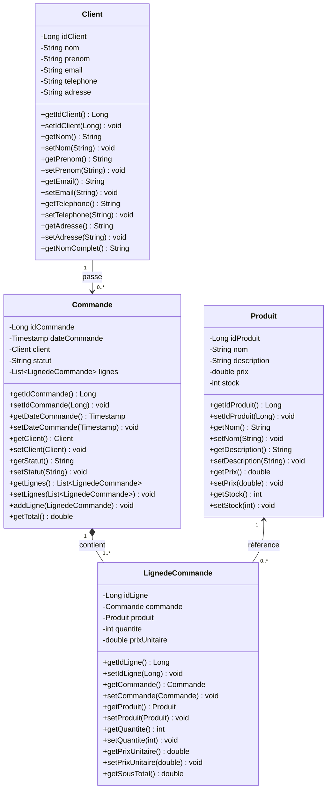

# Mini Rapport : Atelier JEE – Gestion des Commandes Multi-Clients (Architecture MVC 1)

Ce projet implémente une application web dynamique JEE conforme aux standards **Servlet, JSP, Java Bean** selon le patron de conception **MVC 1**, permettant la gestion intégrale des commandes pour plusieurs clients.

---

## 1. Objectifs & Outils

### Objectifs
- Maîtriser le développement JEE standard : Servlets, JavaServer Pages (JSP), JavaBeans.
- Implémenter l'architecture MVC 1 (Modèle - Vue - Contrôleur).
- Mettre en œuvre la persistance relationnelle avec JDBC et MySQL.
- Intégrer l'injection de dépendances CDI via les annotations `@Inject` et `@ApplicationScoped`.
- Structurer un projet web dynamique avec Maven et supporter le déploiement sous Apache Tomcat et Eclipse.

### Outils & Technologies
- **IDE** : Eclipse IDE for Enterprise Java and Web Developers / IntelliJ IDEA
- **Build tool** : Apache Maven 3.9+
- **Serveur d'application** : Apache Tomcat 9 / 10 (Servlet API 3.1+)
- **SGBD** : MySQL Server 8.0+
- **Connecteur SGBD** : MySQL Connector/J 9.4.0
- **CDI** : JBoss Weld Servlet Core & javax.enterprise:cdi-api
- **Vues** : JSP 2.3 & JSTL 1.2 avec Bootstrap 5.3

---

## 2. Étape 1 : Diagramme de Classes

Le système s'articule autour de quatre entités fondamentales :
- **Client** : Représente l'acheteur (nom, prénom, email, téléphone, adresse).
- **Commande** : Représente une commande passée à une date donnée par un client avec un statut (EN_COURS, EXPEDIEE, LIVREE, ANNULEE).
- **Produit** : Représente un article du catalogue (nom, description, prix unitaire, stock disponible).
- **LignedeCommande** : Entité d'association modélisant chaque ligne d'une commande (quantité commandée, prix unitaire appliqué).



---

## 3. Étape 2 : Schéma de Base de Données (MySQL)

Le diagramme de classe a été traduit vers un schéma relationnel normalisé sous MySQL (`mydb`).

### Schéma Relationnel
- `client` (**id_client**, nom, prenom, email, telephone, adresse)
- `produit` (**id_produit**, nom, description, prix, stock)
- `commande` (**id_commande**, date_commande, #id_client, statut)
- `lignedecommande` (**id_ligne**, #id_commande, #id_produit, quantite, prix_unitaire)

### Script SQL (`sql/schema.sql`)
```sql
CREATE TABLE IF NOT EXISTS client (
    id_client INT AUTO_INCREMENT PRIMARY KEY,
    nom VARCHAR(100) NOT NULL,
    prenom VARCHAR(100) NOT NULL,
    email VARCHAR(150) NOT NULL,
    telephone VARCHAR(50),
    adresse VARCHAR(255)
);

CREATE TABLE IF NOT EXISTS produit (
    id_produit INT AUTO_INCREMENT PRIMARY KEY,
    nom VARCHAR(150) NOT NULL,
    description TEXT,
    prix DOUBLE NOT NULL,
    stock INT NOT NULL
);

CREATE TABLE IF NOT EXISTS commande (
    id_commande INT AUTO_INCREMENT PRIMARY KEY,
    date_commande DATETIME NOT NULL DEFAULT CURRENT_TIMESTAMP,
    id_client INT NOT NULL,
    statut VARCHAR(50) NOT NULL DEFAULT 'EN_COURS',
    CONSTRAINT fk_commande_client FOREIGN KEY (id_client) REFERENCES client(id_client) ON DELETE CASCADE
);

CREATE TABLE IF NOT EXISTS lignedecommande (
    id_ligne INT AUTO_INCREMENT PRIMARY KEY,
    id_commande INT NOT NULL,
    id_produit INT NOT NULL,
    quantite INT NOT NULL,
    prix_unitaire DOUBLE NOT NULL,
    CONSTRAINT fk_ligne_commande FOREIGN KEY (id_commande) REFERENCES commande(id_commande) ON DELETE CASCADE,
    CONSTRAINT fk_ligne_produit FOREIGN KEY (id_produit) REFERENCES produit(id_produit) ON DELETE RESTRICT
);
```

---

## 4. Étape 3 : Projet Web Dynamique & Configuration Maven

Le projet est configuré comme projet Web Dynamique avec un descripteur de déploiement Servlet 3.1 (`web.xml`) et un packaging `war` Maven (`pom.xml`).

### Dépendances ajoutées dans `pom.xml`
1. **javax.servlet-api (3.1.0)** : Support des servlets et filtres HTTP.
2. **javax.servlet.jsp-api (2.3.3)** & **jstl (1.2)** : Support des pages JSP et balises JSTL.
3. **mysql-connector-j (9.4.0)** : Pilote JDBC officiel pour MySQL.
4. **cdi-api (1.2)** & **javax.inject (1)** : Annotations de contexte et d'injection de dépendances (`@Inject`, `@ApplicationScoped`).
5. **weld-servlet-core (2.4.8.Final)** : Moteur d'exécution CDI pour serveurs de servlets tels que Tomcat.

---

## 5. Étape 4 : Couche Modèle et Persistance

La couche persistance est organisée en trois packages distincts conformément aux spécifications :

### Package `ma.fstt.entities`
Contient les JavaBeans représentant le modèle de données :
- `Client.java`
- `Produit.java`
- `Commande.java`
- `LignedeCommande.java`

### Package `ma.fstt.service`
Contient les interfaces métier et de persistance utilisées par les classes DAO :
- `IDAO<T>` : Interface générique définissant le contrat CRUD standard :
  - `boolean create(T entity)`
  - `boolean update(T entity)`
  - `boolean delete(Long id)`
  - `T getOne(Long id)`
  - `List<T> getAll()`
- `ClientService` : Étend `IDAO<Client>` avec `Client findByEmail(String email)`.
- `ProduitService` : Étend `IDAO<Produit>` avec `boolean updateStock(Long idProduit, int quantite)`.
- `CommandeService` : Étend `IDAO<Commande>` avec `List<Commande> getByClientId(Long idClient)`.
- `LignedeCommandeService` : Étend `IDAO<LignedeCommande>` avec `List<LignedeCommande> getByCommandeId(Long idCommande)`.

### Package `ma.fstt.dao`
Contient les implémentations concrètes annotées `@ApplicationScoped` pour être injectables via CDI :
- `DatabaseConnection.java` : Gestionnaire de connexions JDBC s'appuyant sur `db.properties`.
- `ClientDAO.java` : Implémentation JDBC des opérations sur les clients.
- `ProduitDAO.java` : Implémentation JDBC avec contrôle de stock disponible.
- `CommandeDAO.java` : Implémentation JDBC transactionnelle assurant la cohérence lors de la création d'une commande (insertion de la commande, de chaque ligne et décrémentation atomique du stock produit).
- `LignedeCommandeDAO.java` : Implémentation JDBC pour la gestion unitaire des lignes de commande.

---

## 6. Étape 5 : Servlets, Vues JSP et JSTL

L'application web expose trois espaces principaux avec des opérations CRUD complètes :

### Contrôleurs (Package `ma.fstt.web`)
- **ClientServlet** (`/clients`) :
  - `list` : Affichage de tous les clients.
  - `new` / `insert` : Formulaire et création d'un client.
  - `edit` / `update` : Formulaire et modification d'un client.
  - `delete` : Suppression d'un client par son identifiant.
- **ProduitServlet** (`/produits`) :
  - CRUD complet sur les articles et suivi des stocks.
- **CommandeServlet** (`/commandes`) :
  - `list` : Liste des commandes avec calcul dynamique des totaux.
  - `new` / `insert` : Création d'une commande avec sélection du client et ajout dynamique de plusieurs articles avec quantités.
  - `details` : Affichage de la facture/détails complets avec sous-totaux par ligne.
  - `edit` / `update` : Modification du statut (EN_COURS, EXPEDIEE, LIVREE, ANNULEE).
  - `delete` : Suppression en cascade de la commande et de ses lignes.
- **HomeServlet** (`/home`, `/`) :
  - Tableau de bord avec indicateurs clés (total clients, total articles, total commandes, chiffre d'affaires et 5 dernières commandes).

### Vues JSP (`src/main/webapp/WEB-INF/views/`)
- Utilisation exclusive de balises JSTL : `<c:forEach>`, `<c:if>`, `<c:choose>`, `<c:out>`, `<fmt:formatDate>`, `<fmt:formatNumber>`.
- Mise en page responsive et ergonomique avec Bootstrap 5.

---

## 7. Structure Globale du Projet

```
websev_mvc/
├── pom.xml
├── README.md
├── sql/
│   └── schema.sql
├── src/
│   └── main/
│       ├── java/
│       │   └── ma/
│       │       └── fstt/
│       │           ├── entities/
│       │           │   ├── Client.java
│       │           │   ├── Commande.java
│       │           │   ├── LignedeCommande.java
│       │           │   └── Produit.java
│       │           ├── service/
│       │           │   ├── ClientService.java
│       │           │   ├── CommandeService.java
│       │           │   ├── IDAO.java
│       │           │   ├── LignedeCommandeService.java
│       │           │   └── ProduitService.java
│       │           ├── dao/
│       │           │   ├── ClientDAO.java
│       │           │   ├── CommandeDAO.java
│       │           │   ├── DatabaseConnection.java
│       │           │   ├── LignedeCommandeDAO.java
│       │           │   └── ProduitDAO.java
│       │           └── web/
│       │               ├── ClientServlet.java
│       │               ├── CommandeServlet.java
│       │               ├── HomeServlet.java
│       │               └── ProduitServlet.java
│       ├── resources/
│       │   └── db.properties
│       └── webapp/
│           ├── index.jsp
│           └── WEB-INF/
│               ├── beans.xml
│               ├── web.xml
│               └── views/
│                   ├── common/
│                   │   ├── footer.jsp
│                   │   └── header.jsp
│                   ├── clients/
│                   │   ├── form.jsp
│                   │   └── list.jsp
│                   ├── produits/
│                   │   ├── form.jsp
│                   │   └── list.jsp
│                   ├── commandes/
│                   │   ├── details.jsp
│                   │   ├── edit.jsp
│                   │   ├── form.jsp
│                   │   └── list.jsp
│                   └── dashboard.jsp
```

---

## 8. Instructions d'Exécution

### 1. Initialiser la base de données MySQL
```bash
mysql -u javauser -p mydb < sql/schema.sql
```

### 2. Compiler et packager le projet avec Maven
```bash
mvn clean package
```
Le fichier généré sera `target/websev_mvc.war`.

### 3. Déploiement
- **Sous Tomcat** : Déposer `target/websev_mvc.war` dans le dossier `webapps/` de Tomcat puis démarrer le serveur.
- **Sous Eclipse** : Importer le projet en tant que projet Maven existant (`File > Import > Existing Maven Projects`), puis faire un clic droit sur le projet > `Run As > Run on Server` (Tomcat 9 ou supérieur).
- **Accès à l'application** : Ouvrir le navigateur à l'adresse `http://localhost:8080/websev_mvc/`.
